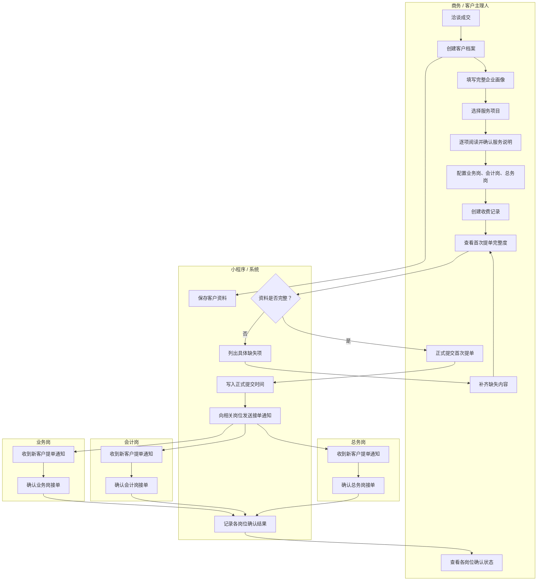
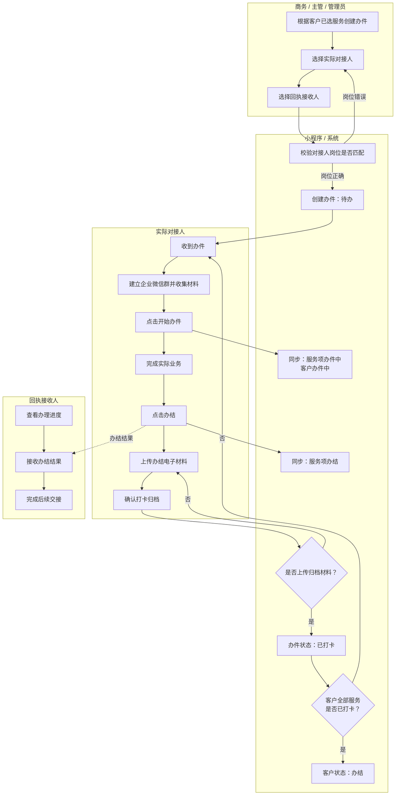
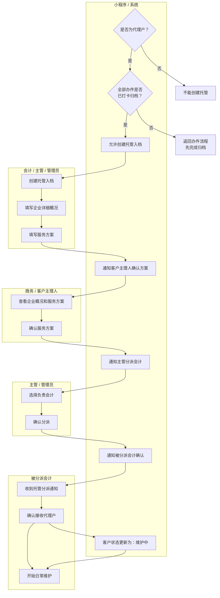
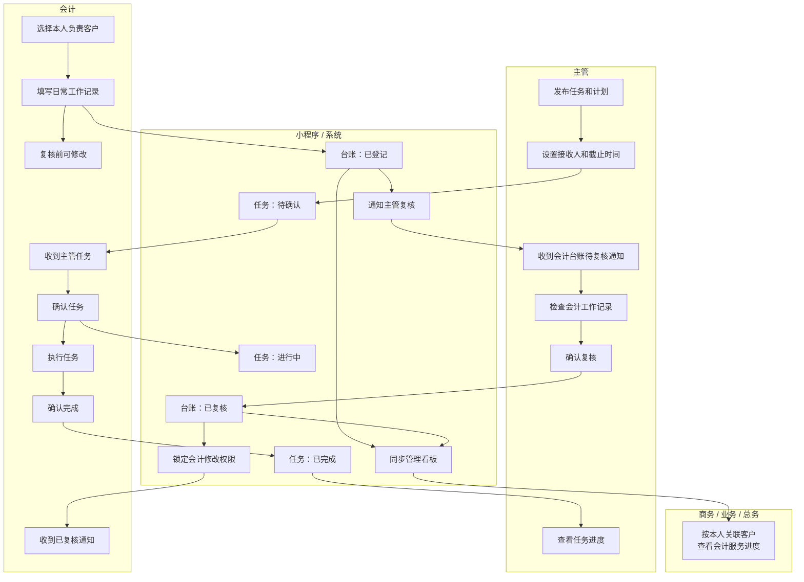
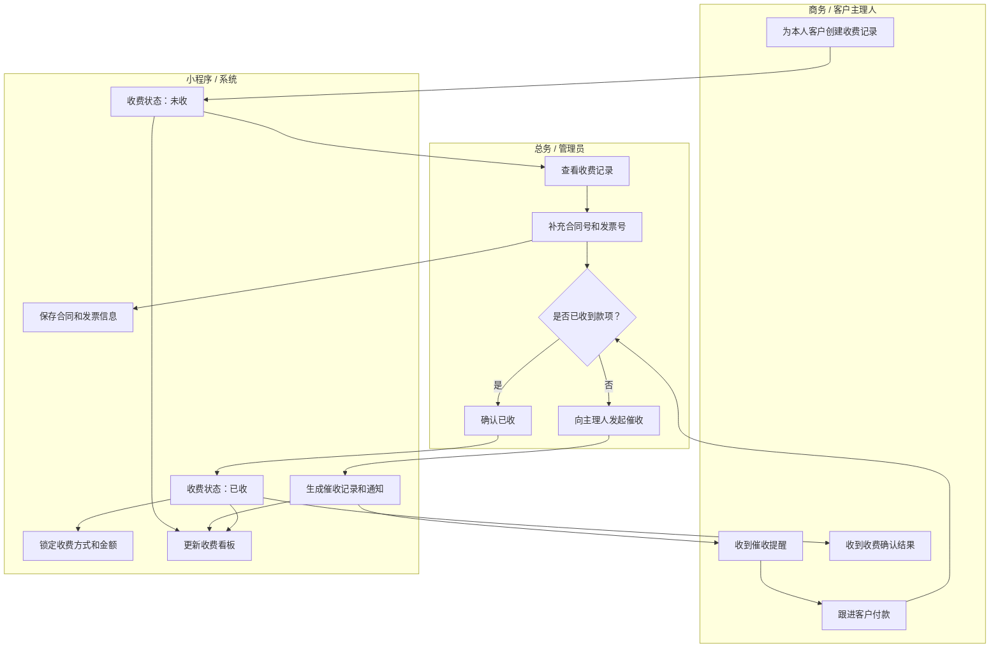
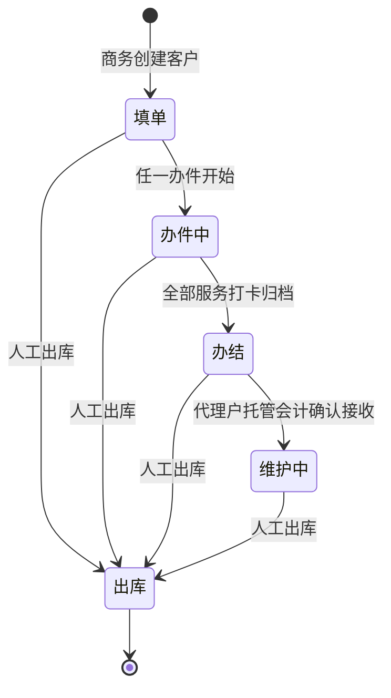

# 君册财税内部员工小程序泳道流程图

> 依据：《君册财税内部员工小程序使用手册（面向用户）》  
> 版本：第一期验收版  
> 最后更新：2026-07-25  
> 说明：为保证可读性，完整流程拆分为五张阶段泳道图。裂变业务等待需求确认，本文件暂不包含。

---

## 一、全流程总览

```text
成交客户
  ↓
商务创建客户档案
  ↓
选择服务 + 阅读确认 + 配置人员 + 创建收费
  ↓
正式提交首次提单
  ↓
业务 / 会计 / 总务确认岗位接单
  ↓
创建办件 → 实际对接人办理 → 办结 → 上传材料 → 打卡归档
  ↓
全部服务完成归档
  ├─ 新用户：客户进入“办结”
  └─ 代理户：创建托管 → 商务确认方案 → 主管分派会计
              → 会计确认接收 → 客户进入“维护中”
  ↓
会计日常登记 → 主管复核 → 管理看板汇总
```

---

## 二、阶段一：客户建档与首次提单



### 首次提单完整条件

1. 企业画像完整。
2. 至少选择一项服务。
3. 主理人已经阅读确认全部已选服务。
4. 已配置业务岗、会计岗和总务岗。
5. 已创建收费记录。

> 正式提交后修改企业资料、服务、人员配置或收费记录，原提交和岗位确认会自动失效，必须重新提交。

---

## 三、阶段二：办件、办结与归档



### 两类人员的区别

| 人员 | 负责事项 | 是否能操作办件 |
|---|---|---|
| 对接人 | 实际办理、开始办件、办结、上传材料、打卡归档 | 可以 |
| 回执接收人 | 查看进度、接收结果、完成后续交接 | 不可以 |

办件状态只能按以下顺序流转：

```text
待办 → 办件中 → 办结 → 已打卡
```

---

## 四、阶段三：代理户托管



### 托管强制顺序

```text
全部办件打卡归档
  → 填写企业概况和服务方案
  → 客户主理人确认方案
  → 主管分派会计
  → 被分派会计确认接收
  → 客户进入维护中
```

禁止操作：

- 办件未全部归档时创建托管。
- 企业概况或服务方案为空时创建托管。
- 主理人未确认方案时分派会计。
- 方案确认后修改企业概况或服务方案。
- 会计确认接收后重新分派。

---

## 五、阶段四：会计日常维护与主管任务



### 会计台账类型

- 客户入库
- 客户出库
- 开票登记
- 日常咨询
- 账务进度
- 社保明细
- 报税进度
- 年报进度
- 其他

---

## 六、阶段五：收费、合同、发票与催收



### 收费权限

| 操作 | 商务 | 总务 | 管理员 | 其他角色 |
|---|---:|---:|---:|---:|
| 为本人客户创建收费记录 | 可以 | 可以 | 可以 | 不可以 |
| 查看本人客户收费 | 可以 | 全部 | 全部 | 不可以 |
| 修改合同号、发票号 | 不可以 | 可以 | 可以 | 不可以 |
| 确认已收 | 不可以 | 可以 | 可以 | 不可以 |
| 发起催收 | 不可以 | 可以 | 可以 | 不可以 |
| 已收后修改金额或收费方式 | 不可以 | 不可以 | 不可以 | 不可以 |

---

## 七、客户状态变化汇总



> “出库”为人工终态，系统不会自动把出库客户重新变为办件中、办结或维护中。

---

## 八、角色交接关系

| 上一岗位 | 交接内容 | 下一岗位 | 系统确认动作 |
|---|---|---|---|
| 商务 | 客户资料、服务、人员、收费 | 业务/会计/总务 | 确认岗位接单 |
| 商务/主管 | 办件任务 | 实际对接人 | 开始办件 |
| 实际对接人 | 办结结果和电子材料 | 回执接收人 | 办结、打卡归档 |
| 业务办件环节 | 完整代理档案 | 托管环节 | 创建托管入档 |
| 托管建档人员 | 企业概况和服务方案 | 商务主理人 | 确认服务方案 |
| 商务主理人 | 已确认的服务方案 | 主管 | 分派会计 |
| 主管 | 代理户托管责任 | 被分派会计 | 确认接收 |
| 会计 | 日常工作记录 | 主管 | 确认复核 |
| 总务 | 收费确认或催收要求 | 商务主理人 | 收费通知 |

